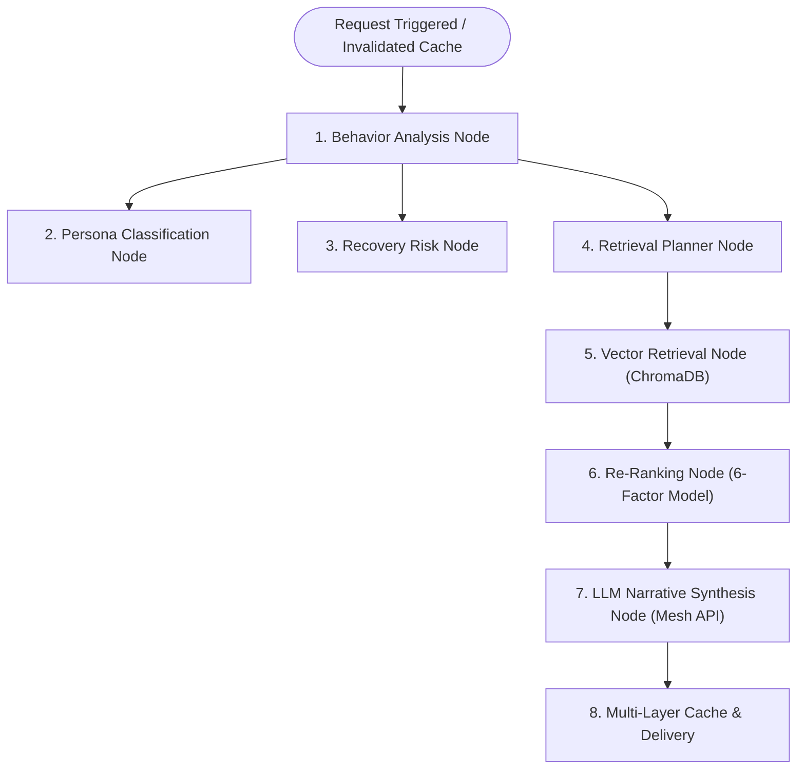

# SmartReco — Comprehensive AI Engine & System Architecture Guide

> **Official Technical Specification for the SmartReco 7-Agent LangGraph Pipeline, Telemetry Engine, Vector RAG Search, and Mesh API Gateway**  
> 🌐 **Live Production Frontend Application**: [https://smart-reco-e6sa-j88lomivq-mayurs-projects-2c59cfae.vercel.app/](https://smart-reco-e6sa-j88lomivq-mayurs-projects-2c59cfae.vercel.app/)

---

## 📖 Table of Contents
1. [Executive Summary](#1-executive-summary)
2. [End-to-End System Architecture](#2-end-to-end-system-architecture)
3. [LangGraph State Machine Pipeline](#3-langgraph-state-machine-pipeline)
4. [Deep Dive: The 7 AI Subsystem Engines](#4-deep-dive-the-7-ai-subsystem-engines)
   - [Engine 1: Behavioral Telemetry & Aggregation (`BehaviorAgent`)](#engine-1-behavioral-telemetry--aggregation-behavioragent)
   - [Engine 2: Persona Classification (`PersonaAgent`)](#engine-2-persona-classification-personaagent)
   - [Engine 3: Churn & Risk Recovery (`RecoveryAgent`)](#engine-3-churn--risk-recovery-recoveryagent)
   - [Engine 4: Semantic Query Planning (`RetrievalPlanner`)](#engine-4-semantic-query-planning-retrievalplanner)
   - [Engine 5: Vector Retrieval & RAG (`VectorRetrievalAgent`)](#engine-5-vector-retrieval--rag-vectorretrievalagent)
   - [Engine 6: Multi-Factor Re-Ranking (`RankingAgent`)](#engine-6-multi-factor-re-ranking-rankingagent)
   - [Engine 7: LLM Narrative Synthesis (`NarrativeAgent` + Mesh API)](#engine-7-llm-narrative-synthesis-narrativeagent--mesh-api)
5. [Real-Time Telemetry & Dwell Time Mechanics](#5-real-time-telemetry--dwell-time-mechanics)
6. [Multi-Layer Caching & MD5 Event Invalidation](#6-multi-layer-caching--md5-event-invalidation)
7. [Database Schema & Data Layer](#7-database-schema--data-layer)

---

## 1. Executive Summary

**SmartReco** is an enterprise-grade behavioral AI recommendation system designed for modern online learning platforms. Rather than relying on simple static recommendation queries or collaborative filtering alone, SmartReco captures real-time learner interactions (views, search queries, course enrollments, module completions, un-enrollments, scroll depths, and dynamic dwell times), processes them through a **7-agent LangGraph workflow**, retrieves grounded course candidates via **ChromaDB vector search**, and synthesizes personalized roadmaps using the **Mesh API LLM Gateway**.

---

## 2. End-to-End System Architecture

```
┌───────────────────────────────────────────────────────────────────────────────────────────┐
│                                   SmartReco Monorepo                                      │
├─────────────────────────────────────────────┬─────────────────────────────────────────────┤
│                 Frontend                    │                   Backend                   │
│          (React 18 + Vite + TS)             │              (FastAPI + Python)            │
│  ┌───────────────────────────────────────┐  │  ┌───────────────────────────────────────┐  │
│  │ Learner Dashboard │ Activity Stream   │  │  │ API Layer (Auth, Events, Recs, Catalog)│  │
│  │ Course Catalog    │ AI Recommendations│  │  │ LangGraph Multi-Agent Workflow Engine │  │
│  │ Course Detail Hub │ My Courses        │  │  └───────────────────┬───────────────────┘  │
│  └───────────────────┬───────────────────┘  │                      │                      │
└──────────────────────┼──────────────────────┴──────────────────────┼──────────────────────┘
                       │ HTTP / REST API (JWT Bearer Auth)           │
                       ▼                                             ▼
┌───────────────────────────────────────────────────────────────────────────────────────────┐
│                                   Services & Data Layer                                   │
│  ┌──────────────────┐  ┌──────────────────┐  ┌──────────────────┐  ┌──────────────────┐  │
│  │    PostgreSQL    │  │     Redis        │  │     ChromaDB     │  │     Mesh API     │  │
│  │(Users, Products, │  │(Cache, Lock,     │  │ (Vector Store &  │  │ (LLM Narrative   │  │
│  │ Events, Recs)    │  │ Persona Keys)    │  │ Similarity Search│  │    Generation)   │  │
│  └──────────────────┘  └──────────────────┘  └──────────────────┘  └──────────────────┘  │
└───────────────────────────────────────────────────────────────────────────────────────────┘
```

---

## 3. LangGraph State Machine Pipeline

The execution flow of the recommendation system is modeled as a state machine using **LangGraph** ([workflow.py](file:///c:/proj/SmartReco/smartreco/backend/app/langgraph/workflow.py)). State is passed sequentially through nodes via an immutable `AgentState` object:



---

## 4. Deep Dive: The 7 AI Subsystem Engines

### Engine 1: Behavioral Telemetry & Aggregation (`BehaviorAgent`)
- **File**: [`backend/app/agents/behavior_agent.py`](file:///c:/proj/SmartReco/smartreco/backend/app/agents/behavior_agent.py)
- **Role**: Ingests raw interaction logs for a user over a lookback window (default 72 hours) and constructs a structured `BehaviorSummary`.
- **Temporal Decay**: Events are weighted according to age:
  $$\text{Recency Weight} = 1.0 + \left(1.0 - \frac{\text{event\_age\_hours}}{72}\right) \times 2.0 \quad (\text{Range: } 1.0\times \rightarrow 3.0\times)$$
- **Intent Weighting Matrix**:
  | Event Type | Base Intent Weight | Description |
  |---|:---:|---|
  | `ENROLL` | **+50** | Strong intent to commit to domain |
  | `RE_ENROLL` | **+60** | Highest commitment signal after un-enrollment |
  | `MODULE_WATCH` | **+25** | High active interest watching module lecture video streams |
  | `MODULE_COMPLETE` | **+20** | Active learning progression completing modules |
  | `LESSON_COMPLETE` | **+8** | Granular learning progress |
  | `ADD_TO_CART` / `WISHLIST` | **+5** | High purchasing/learning interest |
  | `VIEW_PRODUCT` | **+3** | Explicit course exploration |
  | `VIEW_CATEGORY` / `SEARCH` | **+1** | General interest signal |
- **Un-enrollment Intent Reset**: When an `UNENROLL` event occurs:
  - `categories_explored[category]` is **instantly reset to 0** so the dropped domain stops dominating recommendations.
  - Dropped course titles are removed from `recent_product_titles` and `last_viewed_product_title`.

---

### Engine 2: Persona Classification (`PersonaAgent`)
- **File**: [`backend/app/agents/persona_agent.py`](file:///c:/proj/SmartReco/smartreco/backend/app/agents/persona_agent.py)
- **Role**: Evaluates the `BehaviorSummary` against feature heuristics to assign one of 6 learner personas:
  1. `CURIOUS_EXPLORER`: High domain switching (>3 categories), multiple broad searches.
  2. `FOCUSED_BUILDER`: High completion rate (>2 modules) in a single category.
  3. `CAREER_SWITCHER`: High enrollment count across beginner and advanced tracks.
  4. `OVERWHELMED_LEARNER`: High scroll depth, high dwell time, zero module completions.
  5. `PRICE_SENSITIVE`: Repeated catalog filtering by price or low purchase conversions.
  6. `DROP_OFF_RISK`: High dwell time followed by un-enrollment events.

---

### Engine 3: Churn & Risk Recovery (`RecoveryAgent`)
- **File**: [`backend/app/agents/recovery_agent.py`](file:///c:/proj/SmartReco/smartreco/backend/app/agents/recovery_agent.py)
- **Role**: Monitors risk indicators (recent un-enrollments, prolonged dwell time without progress, high exit events) to activate supportive recovery banners and adjusted recommendation pathways.

---

### Engine 4: Semantic Query Planning (`RetrievalPlanner`)
- **File**: [`backend/app/agents/retrieval_agent.py`](file:///c:/proj/SmartReco/smartreco/backend/app/agents/retrieval_agent.py)
- **Role**: Converts learner behavioral intent into an optimized retrieval plan (`RetrievalPlan`).
- **Exclusion Filters**: Populates `exclude_product_ids` with:
  - All currently enrolled course UUIDs.
  - All explicitly un-enrolled / dropped course UUIDs.
- **Dynamic Semantic Query Formulation**: Combines high-intent keywords, search queries, and active target categories into an expressive query vector input.

---

### Engine 5: Vector Retrieval & RAG (`VectorRetrievalAgent`)
- **Files**: [`backend/app/agents/retrieval_agent.py`](file:///c:/proj/SmartReco/smartreco/backend/app/agents/retrieval_agent.py) | [`backend/app/vector/chroma_client.py`](file:///c:/proj/SmartReco/smartreco/backend/app/vector/chroma_client.py)
- **Role**: Executes vector similarity search against the **ChromaDB** vector database initialized with `SentenceTransformer('all-MiniLM-L6-v2')` embeddings.
- **Resilience**: If ChromaDB vector retrieval returns fewer than required candidates, automatically falls back to an exclusion-filtered PostgreSQL query.

---

### Engine 6: Multi-Factor Re-Ranking (`RankingAgent`)
- **File**: [`backend/app/agents/ranking_agent.py`](file:///c:/proj/SmartReco/smartreco/backend/app/agents/ranking_agent.py)
- **Role**: Ranks retrieved candidates using a 6-factor mathematical scoring model:
  $$\text{Raw Score} = w_1 S_{\text{semantic}} + w_2 S_{\text{difficulty}} + w_3 S_{\text{progression}} + w_4 S_{\text{price}} + w_5 S_{\text{tags}} + w_6 S_{\text{freshness}} + \text{Boosts} - \text{Penalties}$$
  - **Weights**: Semantic 35%, Difficulty 20%, Progression 15%, Price 10%, Tags 10%, Freshness 10%.
  - **Progression Boosts**:
    - Active Enrolled Track Boost: **+0.35**
    - Module/Lesson Completion Boost: **+0.15 to +0.30**
    - Category View Boost: **+0.25**
  - **Un-Enrollment Hard Clamp**: Any candidate matching an un-enrolled course ID or title is assigned `final_score = 0.0` and excluded from `ranked_products`.

---

### Engine 7: LLM Narrative Synthesis (`NarrativeAgent` + Mesh API)
- **File**: [`backend/app/agents/narrative_agent.py`](file:///c:/proj/SmartReco/smartreco/backend/app/agents/narrative_agent.py)
- **Role**: Synthesizes structured personalized narratives using the mandatory **Mesh API Gateway** (`https://api.meshapi.ai/v1`) using `openai.AsyncOpenAI`.
- **Output Schema**:
  - `top_category`: Matches the #1 ranked recommendation category.
  - `learning_goal`: Persuasive, actionable learning milestone.
  - `user_journey_narrative`: 2-3 sentence personalized learning narrative.
  - `roadmap`: 3-step structured learning path.
  - `product_explanations`: Contextual explanations detailing *why* each course was recommended.

---

## 5. Real-Time Telemetry & Dwell Time Mechanics

SmartReco captures continuous telemetry without interrupting learner UX:

```
Learner Page Entrance -> Log view_category / view_product (dwell = initial)
                       -> Interval (every 10s) -> Log time_on_page (dwell = elapsed)
Learner Page Leave    -> Log time_on_page (dwell = exact total seconds spent)
```

- **Global Route Tracking (`App.tsx`)**: Top-level `RouteTracker` listens to React Router location changes and logs exact dynamic dwell time on page transitions (`actualDwell = (now - startTime) / 1000`).
- **Course Detail Tracking (`CourseDetailPage.tsx`)**: Logs continuous dwell telemetry every 10 seconds while a learner reads course materials or watches module video streams.

---

## 6. Multi-Layer Caching & MD5 Event Invalidation

Recommendation generation is computationally intensive. SmartReco uses a two-tier caching architecture validated by a digital behavioral fingerprint ([recommendation_service.py](file:///c:/proj/SmartReco/smartreco/backend/app/services/recommendation_service.py)):

1. **Digital Behavioral Fingerprint**:
   `compute_event_hash()` calculates an MD5 hash over the last 20 user event IDs.
2. **Layer 1 Cache**: Redis key `reco_cache:{user_id}` with 15-minute TTL.
3. **Layer 2 Cache**: PostgreSQL `recommendation_cache` table.
4. **Cache Invalidation**: On any user action (`ENROLL`, `UNENROLL`, `MODULE_COMPLETE`), `compute_event_hash()` changes. `should_regenerate()` evaluates to `True`, triggering instant background pipeline regeneration.

---

## 7. Database Schema & Data Layer

SmartReco utilizes PostgreSQL managed via SQLAlchemy AsyncSession:
- `users`: User authentication, credentials, and profile settings.
- `products`: Product catalog metadata, categories, tags, price, difficulty, and duration.
- `events`: User interaction telemetry (views, enrollments, completions, un-enrollments, dwell times).
- `recommendations`: Historical generated recommendations and structured roadmaps.
- `recommendation_cache`: Cached JSON recommendation payloads keyed by user ID and event hash.
